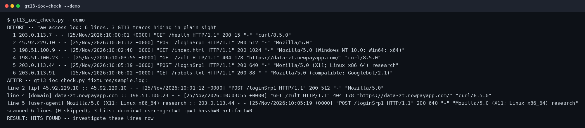

# gt13-ioc-check



**Point it at a Check Point access log and in ~41 ms (median of 7 runs on this machine) it tells you whether GreyNoise's GT13 campaign — 24 management servers hit at 22 organizations — ever touched your network.**

GreyNoise disclosed GT13 on 2026-11-23: an intrusion campaign against Check Point Security Management Servers, with confirmed activity 2026-10-17 to 2026-11-02 and believed still ongoing. The attackers copied firewall databases and internal certificate authorities, minted certificates, and tried to unload security policies. If you run Check Point, the first question is the simplest one: *do our logs contain any of their traces?* This tool answers it offline, in one command, with zero setup.

## Who this is for

- **Check Point admins and SOC analysts** who need a yes/no answer from last month's access logs before the next patch window — not another threat-intel PDF to read.
- **Incident responders** triaging a suspicious management server: pipe the log through, get flagged lines with IoC type, matched value, and line number.
- **Threat hunters** who want the published GT13 indicators as runnable code instead of a table to copy-paste from.

If it saves you one grep pipeline, star it — and if you find a real hit, please open an issue (sanitized, no customer data) so the community learns what GT13 looks like in the wild.

## Quick start (30 seconds, Python 3 only, no dependencies)

```bash
# 1. See it work on the bundled demo log (3 planted GT13 traces)
python3 gt13_ioc_check.py --demo

# 2. Scan the bundled sample log — expect exit code 1 (hits found, by design)
python3 gt13_ioc_check.py fixtures/sample.log; echo "exit=$?"

# 3. Scan your own log (file args, or pipe via stdin)
python3 gt13_ioc_check.py /var/log/apache2/access.log; echo "exit=$?"
cat /var/log/apache2/access.log | python3 gt13_ioc_check.py; echo "exit=$?"

# 4. Run the tests
python3 tests/run_tests.py
```

## Example output

The block below is the exact output of `python3 gt13_ioc_check.py --demo` (also saved as `demo.txt`):

```
$ gt13_ioc_check.py --demo
BEFORE -- raw access log: 6 lines, 3 GT13 traces hiding in plain sight
  1 203.0.113.7 - - [25/Nov/2026:10:00:01 +0000] "GET /health HTTP/1.1" 200 15 "-" "curl/8.5.0"
  2 45.92.229.10 - - [25/Nov/2026:10:01:12 +0000] "POST /loginSrp1 HTTP/1.1" 200 512 "-" "Mozilla/5.0"
  3 198.51.100.9 - - [25/Nov/2026:10:02:40 +0000] "GET /index.html HTTP/1.1" 200 1024 "-" "Mozilla/5.0 (Windows NT 10.0; Win64; x64)"
  4 198.51.100.23 - - [25/Nov/2026:10:03:55 +0000] "GET /zult HTTP/1.1" 404 178 "https://data-zt.newpayapp.com/" "curl/8.5.0"
  5 203.0.113.44 - - [25/Nov/2026:10:05:19 +0000] "POST /loginSrp1 HTTP/1.1" 200 640 "-" "Mozilla/5.0 (X11; Linux x86_64) research"
  6 203.0.113.91 - - [25/Nov/2026:10:06:02 +0000] "GET /robots.txt HTTP/1.1" 200 88 "-" "Mozilla/5.0 (compatible; Googlebot/2.1)"
AFTER -- gt13_ioc_check.py fixtures/sample.log:
line 2 [ip] 45.92.229.10 :: 45.92.229.10 - - [25/Nov/2026:10:01:12 +0000] "POST /loginSrp1 HTTP/1.1" 200 512 "-" "Mozilla/5.0"
line 4 [domain] data-zt.newpayapp.com :: 198.51.100.23 - - [25/Nov/2026:10:03:55 +0000] "GET /zult HTTP/1.1" 404 178 "https://data-zt.newpayapp.com/" "curl/8.5.0"
line 5 [user-agent] Mozilla/5.0 (X11; Linux x86_64) research :: 203.0.113.44 - - [25/Nov/2026:10:05:19 +0000] "POST /loginSrp1 HTTP/1.1" 200 640 "-" "Mozilla/5.0 (X11; Linux x86_64) research"
scanned 6 lines (0 skipped), 3 hits: domain=1 user-agent=1 ip=1 hassh=0 artifact=0
RESULT: HITS FOUND -- investigate these lines now
```

Before the scan, the three traces are invisible in the raw log. After it, each flagged line names its IoC type, the matched value, and the line number — then a one-line summary with per-type counts.

## What it checks

Every indicator is copied verbatim from the GreyNoise report ([primary source](https://www.greynoise.io/blog/check-point-security-management-servers-intrusion-campaign)):

| Type | Count | Values |
| --- | --- | --- |
| Domain | 4 | newpayapp[.]com, data-zt.newpayapp[.]com, api-zt.newpayapp[.]com, 2ev5.newpayapp[.]com |
| User-Agent | 2 | `Mozilla/5.0 (X11; Linux x86_64) research`, `Mozilla/5.0 research` |
| IP address | 69 | ExpressVPN exits, AS206092 (full list in `gt13_ioc_check.py`) |
| HASSH | 1 | `eeca2460550b9ded084ecf2f70a75356` (OpenSSH 10) |
| Artifact | 1 | `/usr/lib/.libproc.so` (seen via `/etc/ld.so.preload`) |

Matching details: domain matches cover subdomains; defanged indicators pasted into logs (`newpayapp[.]com`) are still flagged; IP matches are exact (a listed `45.92.229.10` does not match `45.92.229.100`); HASSH matches inside SSH/connection logs, not just HTTP logs; malformed lines are skipped, never fatal.

## Exit codes

| Code | Meaning |
| --- | --- |
| 0 | No GT13 indicators found |
| 1 | Hits found — investigate the flagged lines |
| 2 | Usage error (unknown flag, unreadable file) |

## IoC completeness — read this before you trust a "clean"

- **IPs: 69 of 99 published.** GreyNoise says GT13 used 99 IPs; the 69 in this tool are the ExpressVPN exits the report enumerates with first/last-seen times. The other ~30 were compromised victim Check Point devices and are **not listed** in the report. A clean IP result does **not** clear you.
- **HASSH is a weak signal on its own.** GreyNoise's own note: the hash is common (OpenSSH 10) but useful combined with other GT13 traits, such as ExpressVPN use. Treat a lone HASSH hit as a lead, not a verdict.
- **ExpressVPN exits are shared infrastructure.** An IP hit means "this address was a GT13 exit at that time" — investigate the session, don't assume compromise from the address alone.
- **The campaign is believed ongoing.** GreyNoise lost visibility on 2026-11-02 but assesses GT13 still has persistent access to victim devices. Re-scan new logs; indicators may grow — check the GreyNoise report for updates.

## Limitations

- Offline text matching only: it finds the published indicators, nothing more. It does not detect the CVE-2026-16232 exploit itself, unknown infrastructure, or the ZULT implant's behavior.
- HTTP access-log shaped input is assumed; other log formats still scan as text, but line numbers count scanned lines only.
- No network calls at scan time, no accounts, no telemetry, no data leaves your machine.

## Sources

- GreyNoise, "An Active Intrusion Campaign Against Check Point Security Management Servers", 2026-11-23 — https://www.greynoise.io/blog/check-point-security-management-servers-intrusion-campaign
- BleepingComputer, "Hackers compromise Check Point Servers in 22 organizations", 2026-11-24 (updated 2026-11-25 with Check Point's statement confirming CVE-2026-16232 use) — https://www.bleepingcomputer.com/news/security/hackers-compromise-check-point-servers-in-22-organizations/

## License

MIT — see [LICENSE](LICENSE).
